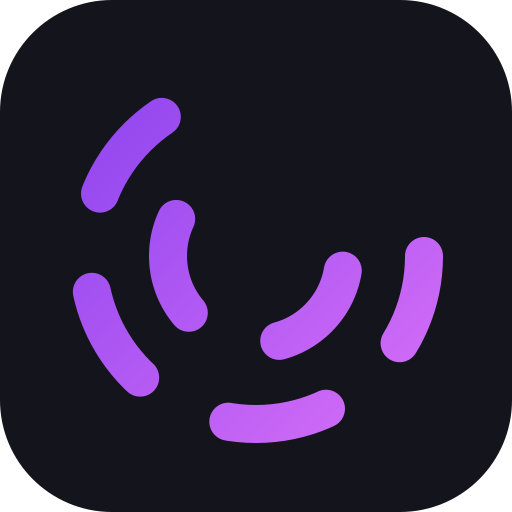
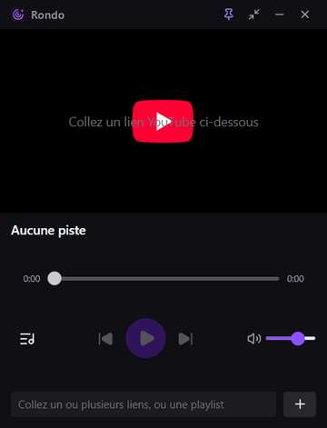
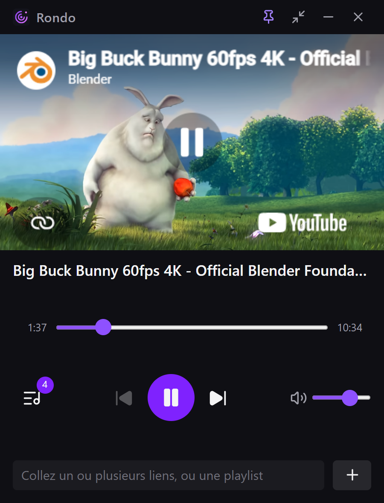
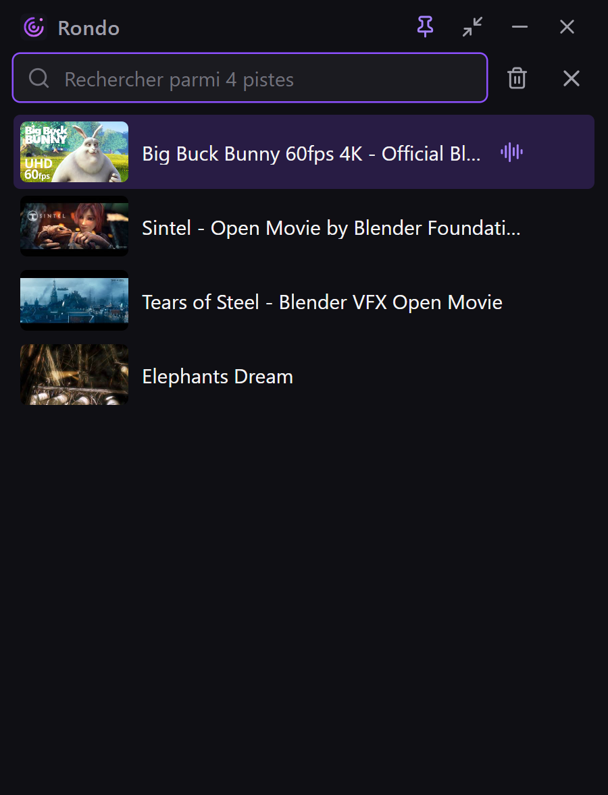
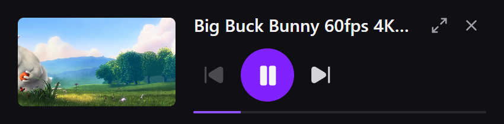

<p align="center">
  
</p>

<h1 align="center">Rondo</h1>

<p align="center">
  <strong>Votre musique YouTube, dans un coin de l'écran.</strong><br>
  Un lecteur léger, toujours visible, qui se réduit en petite carte. Gratuit, local, sans compte.
</p>

<p align="center">
  
</p>

## Pourquoi Rondo

- **Toujours là, jamais gênant.** Une fenêtre sans bordure qui reste au premier plan, ou une carte de
  360 × 290 pixels qui se glisse dans un coin pendant que vous travaillez.
- **Une playlist entière en un collage.** Copiez, faites `Ctrl+V` : tout est ajouté. Plusieurs liens d'un coup,
  une playlist complète, ou un simple glisser-déposer.
- **Rien à créer, rien à configurer.** Pas de compte, pas de serveur, aucune donnée collectée. Votre file reste sur
  votre ordinateur et se retrouve au prochain lancement.
- **Retrouver un titre parmi des centaines.** La recherche instantanée filtre la file pendant que vous tapez.
- **Piloté au clavier.** Les touches multimédia fonctionnent même quand Rondo n'a pas le focus.

## Aperçu

<table>
  <tr>
    <td align="center"><br><sub>Mode complet</sub></td>
    <td align="center"><br><sub>File d'attente</sub></td>
  </tr>
  <tr>
    <td colspan="2" align="center"><br><sub>Mode mini</sub></td>
  </tr>
</table>

## Démarrer

Prérequis : [Node.js](https://nodejs.org) 20 ou plus récent. Testé sous Windows.

```bash
git clone https://github.com/HexaNexus28/music-widget.git
cd music-widget
npm install
npm start
```

Copiez un lien YouTube, faites `Ctrl+V` dans la fenêtre, puis lancez la lecture.

| Commande | Effet |
|---|---|
| `npm run dev` | Développement avec rechargement à chaud |
| `npm start` | Build puis lancement de la version de production |
| `npm run build` | Build et installeur Windows (dossier `release/`) |
| `npm run lint` | Vérification ESLint |

## Documentation

- [Guide d'utilisation](docs/guide-utilisation.md) : les fonctions pas à pas, la confidentialité et les questions
  fréquentes.
- [Architecture technique](docs/architecture.md) : fonctionnement interne, pour contribuer.

## Contribuer

Les issues et les pull requests sont les bienvenues. Avant de proposer une modification, lancez `npm run lint` et
`npm run build`.

## Licence et mentions

Code sous licence [MIT](LICENSE).

Rondo utilise le lecteur intégré de YouTube. Il n'est ni affilié à YouTube ou Google, ni approuvé par eux ;
YouTube est une marque de Google LLC. Les vidéos de démonstration des images sont des films ouverts de la
[Blender Foundation](https://www.blender.org) (licence CC BY 3.0).
